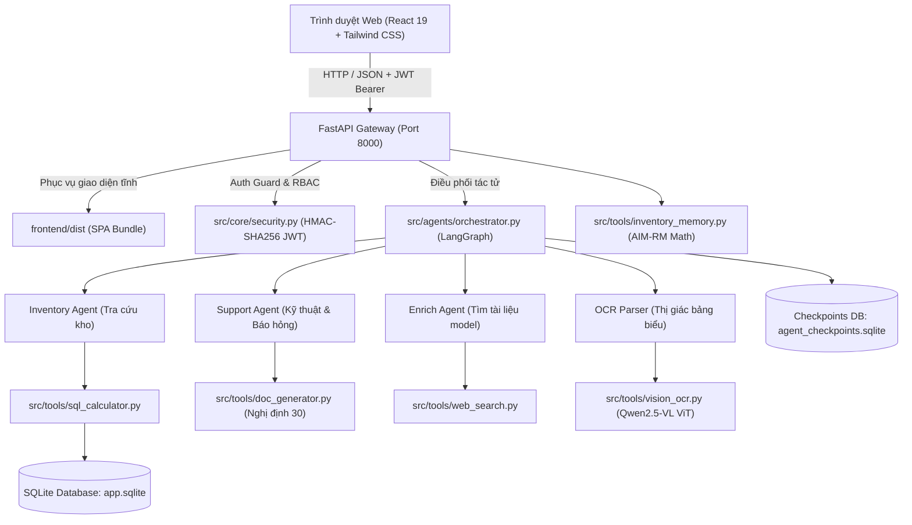
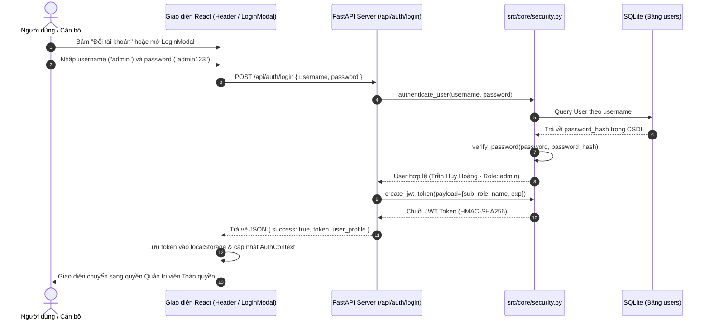
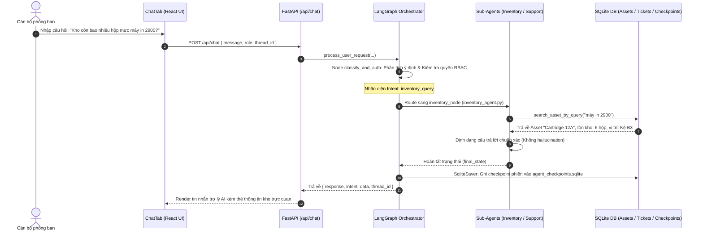
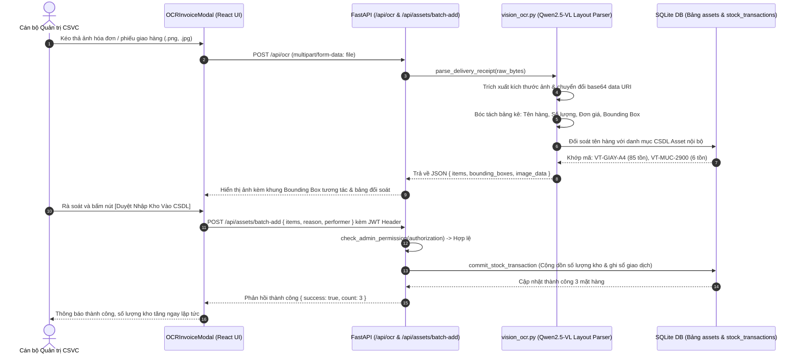
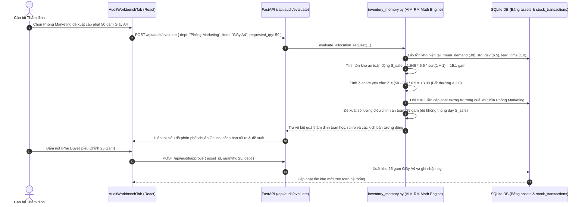
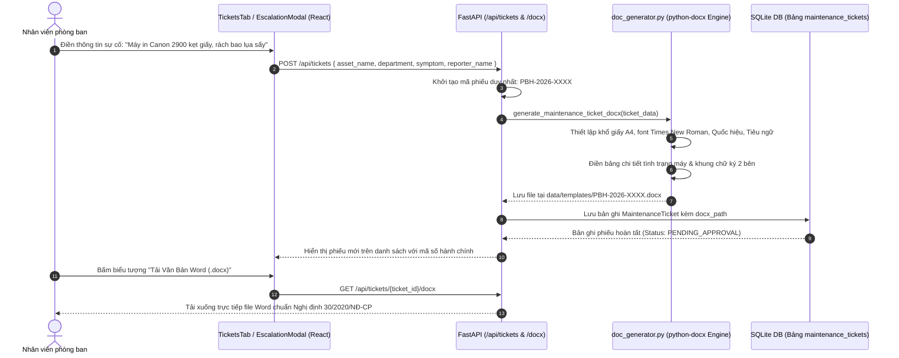

# 📖 TÀI LIỆU TOÀN DIỆN: CẤU TRÚC MÃ NGUỒN, CHỨC NĂNG TỪNG HÀM & QUY TRÌNH HOẠT ĐỘNG (WORKFLOW)
### Dự Án: Office Asset Agent — Hệ Thống Tự Động Hóa Quản Lý Vật Tư & Thiết Bị Văn Phòng Đa Tác Tử

---

## 🗂️ MỤC LỤC
1. [Tổng Quan Kiến Trúc Hệ Thống (Architecture Overview)](#1-tổng-quan-kiến-trúc-hệ-thống)
2. [Bản Đồ Cây Thư Mục & Vai Trò Từng File](#2-bản-đồ-cây-thư-mục--vai-trò-từng-file)
3. [Từ Điển Chi Tiết Từng Module & Hàm Nghiệp Vụ (Function Reference)](#3-từ-điển-chi-tiết-từng-module--hàm-nghiệp-vụ)
   - [3.1. Điểm Khởi Chạy: `run_app.py`](#31-điểm-khởi-chạy-run_apppy)
   - [3.2. Cổng Giao Tiếp REST API: `src/api/server.py`](#32-cổng-giao-tiếp-rest-api-srcapiserverpy)
   - [3.3. Bảo Mật & Xác Thực JWT / RBAC: `src/core/security.py`](#33-bảo-mật--xác-thực-jwt--rbac-srccoresecuritypy)
   - [3.4. Bộ Điều Phối Đa Tác Tử LangGraph: `src/agents/orchestrator.py`](#34-bộ-điều-phối-đa-tác-tử-langgraph-srcagentsorchestratorpy)
   - [3.5. Các Sub-Agents Chuyên Trách: `inventory_agent`, `support_agent`, `enrich_agent`](#35-các-sub-agents-chuyên-trách)
   - [3.6. Công Thức Chuỗi Cung Ứng & Hồi Cứu AIM-RM: `src/tools/inventory_memory.py`](#36-công-thức-chuỗi-cung-ứng--hồi-cứu-aim-rm-srctoolsinventory_memorypy)
   - [3.7. Giao Dịch Kho & Tính Toán SQL: `src/tools/sql_calculator.py`](#37-giao-dịch-kho--tính-toán-sql-srctoolssql_calculatorpy)
   - [3.8. Thị Giác Máy Tính & Bóc Tách Hóa Đơn: `src/tools/vision_ocr.py`](#38-thị-giác-máy-tính--bóc-tách-hóa-đơn-srctoolsvision_ocrpy)
   - [3.9. Sinh Văn Bản Chuẩn Nghị Định 30/2020: `src/tools/doc_generator.py`](#39-sinh-văn-bản-chuẩn-nghị-định-302020-srctoolsdoc_generatorpy)
   - [3.10. Tầng Dịch Vụ & State Frontend: `frontend/src/`](#310-tầng-dịch-vụ--state-frontend-frontendsrc)
4. [Sơ Đồ Quy Trình Hoạt Động (End-to-End Workflows)](#4-sơ-đồ-quy-trình-hoạt-động-end-to-end-workflows)
   - [Workflow 1: Luồng Đăng Nhập & Phân Quyền Bảo Mật JWT (RBAC Flow)](#workflow-1-luồng-đăng-nhập--phân-quyền-bảo-mật-jwt)
   - [Workflow 2: Luồng Chat Đa Tác Tử LangGraph (Multi-Agent Conversation Flow)](#workflow-2-luồng-chat-đa-tác-tử-langgraph)
   - [Workflow 3: Luồng Quét Hóa Đơn & Nhập Kho Tự Động (Qwen2.5-VL Vision OCR Ingestion)](#workflow-3-luồng-quét-hóa-đơn--nhập-kho-tự-động)
   - [Workflow 4: Luồng Thẩm Định Cấp Phát An Toàn AIM-RM (Safe-Stock Audit Flow)](#workflow-4-luồng-thẩm-định-cấp-phát-an-toàn-aim-rm)
   - [Workflow 5: Luồng Báo Hỏng Thiết Bị & Xuất File Word Nghị Định 30 (Maintenance Ticket Flow)](#workflow-5-luồng-báo-hỏng-thiết-bị--xuất-file-word-nghị-định-30)

---

## 1. TỔNG QUAN KIẾN TRÚC HỆ THỐNG

Hệ thống được thiết kế theo kiến trúc **Decoupled Fullstack Monorepo**:
- **Backend**: Xây dựng bằng **FastAPI** (Python 3.11+), sử dụng **SQLite + SQLAlchemy ORM** để đảm bảo khả năng chạy **100% Offline độc lập**, không phụ thuộc cloud database.
- **Frontend**: Xây dựng bằng **React 19 + TypeScript + Vite + Tailwind CSS**, áp dụng thiết kế B2B Enterprise Slate/Zinc hiện đại, loại bỏ hoàn toàn các thành phần "AI slop".
- **AI & Math Core**:
  - **LangGraph StateGraph**: Điều phối tác tử với bộ nhớ phiên làm việc bền vững qua `SqliteSaver`.
  - **AIM-RM Supply Chain Math**: Tính toán mức tồn kho an toàn động $S_{\text{safe}}$ và hồi cứu kịch bản tương đồng bằng khoảng cách toán học.
  - **Qwen2.5-VL Vision Layout Parser**: Bóc tách chứng từ bảng biểu, tạo bounding box và đối soát tự động danh mục CSDL.
  - **python-docx Engine**: Tự động sinh biên bản theo đúng thể thức văn bản hành chính Việt Nam (Nghị định 30/2020/NĐ-CP).



---

## 2. BẢN ĐỒ CÂY THƯ MỤC & VAI TRÒ TỪNG FILE

```
office-asset-agent/
├── run_app.py                      # File khởi chạy duy nhất (hỗ trợ Web Browser và Desktop pywebview)
├── pytest.ini                      # Cấu hình kiểm thử tự động pytest
├── requirements.txt                # Danh sách thư viện Python
├── pyproject.toml                  # Khai báo cấu hình dự án chuẩn PEP 518/621
├── data/
│   ├── app.sqlite                  # Cơ sở dữ liệu nghiệp vụ (tài sản, hóa đơn, người dùng, phiếu báo hỏng)
│   ├── agent_checkpoints.sqlite    # Bộ nhớ lưu vết phiên hội thoại LangGraph (SqliteSaver)
│   ├── templates/                  # File mẫu văn bản Word (.docx)
│   └── uploads/                    # Thư mục lưu file tải lên tạm thời
├── docs/                           # Tài liệu thiết kế hệ thống và cẩm nang kỹ thuật
├── tests/
│   ├── test_api.py                 # Bộ kiểm thử REST API, Auth JWT, OCR và Serving (13 tests)
│   └── test_system.py              # Bộ kiểm thử toán học AIM-RM, LangGraph, CSDL (18 tests)
├── src/                            # TOÀN BỘ MÃ NGUỒN BACKEND PYTHON
│   ├── __init__.py
│   ├── api/
│   │   ├── __init__.py
│   │   └── server.py               # Máy chủ FastAPI REST API & Mount Static Frontend
│   ├── core/
│   │   ├── config.py               # Đường dẫn, hằng số vai trò (ROLE_USER, ROLE_ADMIN), biến môi trường
│   │   ├── database.py             # Khởi tạo SQLAlchemy Engine, SessionLocal, Base
│   │   ├── init_db.py              # Khởi tạo bảng và nạp 10 bản ghi vật tư, 3 tài khoản mẫu
│   │   ├── security.py             # Xử lý mật khẩu, sinh/giải mã JWT, phân quyền RBAC
│   │   └── llm_client.py           # Client kết nối Local Ollama LLM / Vision hoặc fallback Rule
│   ├── models/
│   │   ├── asset.py                # Schema SQLAlchemy: Asset (Tài sản) và KnowledgeDoc (Cẩm nang)
│   │   ├── ticket.py               # Schema SQLAlchemy: MaintenanceTicket và StockTransaction
│   │   └── user.py                 # Schema SQLAlchemy: User (Tài khoản người dùng)
│   ├── tools/
│   │   ├── sql_calculator.py       # Truy vấn kho, thực hiện giao dịch nhập/xuất, tính định giá
│   │   ├── inventory_memory.py     # Toán học AIM-RM: Tồn kho an toàn, Z-score, tương đồng kịch bản
│   │   ├── doc_generator.py        # Sinh file Word Phiếu Báo Hỏng theo thể thức Nghị định 30/2020
│   │   ├── vision_ocr.py           # Bóc tách hóa đơn, nhận diện bảng biểu, sinh Bounding Boxes
│   │   └── web_search.py           # Cào thông tin hướng dẫn thiết bị và tổng hợp tri thức
│   └── agents/
│       ├── orchestrator.py         # Bộ điều phối trung tâm LangGraph, Guardrails, SqliteSaver
│       ├── inventory_agent.py      # Tác tử chuyên môn tra cứu vật tư, định giá, vị trí
│       ├── support_agent.py        # Tác tử chẩn đoán lỗi thiết bị, hướng dẫn tự sửa và lập ticket
│       └── enrich_agent.py         # Tác tử tự động tìm kiếm sách hướng dẫn cho model mới
└── frontend/                       # TOÀN BỘ MÃ NGUỒN FRONTEND REACT + TYPESCRIPT
    ├── index.html                  # Khung HTML gốc của Single Page Application
    ├── package.json                # Quản lý dependencies (React 19, Vite, Tailwind CSS, Lucide)
    ├── vite.config.ts              # Cấu hình Vite build và dev proxy
    ├── dist/                       # Bản build tĩnh đã đóng gói (HTML, JS, CSS) sẵn sàng phục vụ
    └── src/
        ├── main.tsx                # Bootstrap React app vào DOM
        ├── App.tsx                 # Điều hướng các tab chính và gắn CommandMenu, LoginModal
        ├── index.css               # Cấu hình Tailwind CSS và font chữ
        ├── types/                  # Kiểu dữ liệu TypeScript: asset, ticket, audit, auth
        ├── lib/
            ├── math.ts             # Thuật toán thuần túy: AIM-RM, Z-score, Cosine Similarity
            └── formatters.ts       # Định dạng tiền tệ VNĐ, ngày tháng, mã hóa giá theo quyền
        ├── services/
            └── api.ts              # API client giao tiếp trực tiếp với FastAPI backend
        ├── hooks/
            ├── useAuth.tsx         # Quản lý phiên đăng nhập, JWT, vai trò người dùng
            ├── useInventory.tsx    # State danh mục vật tư, tồn kho, cảnh báo thấp
            ├── useTickets.tsx      # State phiếu báo hỏng, phê duyệt, tải docx
            └── useTheme.tsx        # Chuyển đổi giao diện Sáng / Tối (Dark mode)
        └── components/
            ├── layout/             # Header, Sidebar, CommandMenu (Ctrl+K)
            ├── auth/               # LoginModal (Màn hình đăng nhập xác thực RBAC)
            ├── chat/               # ChatTab, OCRInvoiceModal, TicketEscalationModal
            ├── inventory/          # InventoryTab, StockAdjustmentModal
            ├── audit/              # AuditWorkbenchTab (Thẩm định định mức tồn kho an toàn)
            ├── tickets/            # TicketsTab, AdministrativeDocxPreviewModal
            └── knowledge/          # KnowledgeNotebookTab, ModelEnrichmentModal
```

---

## 3. TỪ ĐIỂN CHI TIẾT TỪNG MODULE & HÀM NGHIỆP VỤ

### 3.1. Điểm Khởi Chạy: `run_app.py`
- **Tác dụng**: Là file thực thi chính để khởi động toàn bộ ứng dụng. Thay vì phải chạy riêng rẽ cả backend và frontend, file này tích hợp tự động: khởi tạo CSDL $\rightarrow$ khởi chạy máy chủ FastAPI $\rightarrow$ phục vụ frontend tĩnh tại port 8000 $\rightarrow$ tự động mở trình duyệt (hoặc cửa sổ Desktop).
- **Các hàm chính**:
  - `open_browser(url: str, delay: float = 1.2)`: Chạy trong một luồng (thread) riêng, trì hoãn 1.2 giây để đảm bảo Uvicorn đã sẵn sàng rồi gọi trình duyệt mặc định của hệ thống mở `url`.
  - `run_desktop_window(url: str)`: Dùng thư viện `pywebview` để bọc Web App vào một cửa sổ ứng dụng Desktop độc lập (Native Window kích thước 1320x860) cho trải nghiệm giống phần mềm máy tính chuyên nghiệp.
  - `main()`: Tiếp nhận tham số dòng lệnh (`--port`, `--host`, `--desktop`, `--no-browser`), gọi `init_database()`, và khởi động `uvicorn.run()`.

---

### 3.2. Cổng Giao Tiếp REST API: `src/api/server.py`
- **Tác dụng**: Cung cấp toàn bộ các RESTful API endpoints cho hệ thống, thực hiện xác thực JWT, kiểm tra phân quyền RBAC và phục vụ Single Page Application (SPA).
- **Các nhóm Endpoint cốt lõi**:
  1. `GET /api/health`: Kiểm tra sức khỏe của dịch vụ, trả về uptime và version.
  2. `POST /api/auth/login`: Tiếp nhận `{ username, password }`. Gọi hàm `authenticate_user()`. Nếu đúng, tạo JWT token chứa `sub`, `role`, `department` và trả về profile người dùng.
  3. `GET /api/auth/me`: Đọc header `Authorization: Bearer <token>`, giải mã token và trả về thông tin cán bộ đang đăng nhập.
  4. `POST /api/auth/logout`: Đăng xuất và xóa phiên làm việc.
  5. `GET /api/assets`: Lấy toàn bộ danh mục vật tư & thiết bị trong kho (được serialize theo schema của frontend).
  6. `GET /api/inventory/metrics`: Tính toán tổng quan kho (tổng số mặt hàng, tổng giá trị tồn kho VNĐ, số lượng sắp hết hàng).
  7. `POST /api/assets/adjust`: Điều chỉnh số lượng kho (nhập thêm hoặc xuất kho). **Được bảo vệ bởi `check_admin_permission`** — chỉ tài khoản `admin` mới được thực hiện.
  8. `POST /api/assets/batch-add`: Nhập kho hàng loạt (dùng sau khi duyệt hóa đơn OCR). Yêu cầu quyền `admin`.
  9. `GET /api/tickets`: Lấy danh sách phiếu báo hỏng và biên bản bảo trì.
  10. `POST /api/tickets`: Tạo mới phiếu báo hỏng, tự động sinh file Word `.docx` chuẩn Nghị định 30/2020/NĐ-CP và lưu đường dẫn vào database.
  11. `PATCH /api/tickets/{ticket_id}/status`: Cập nhật trạng thái phiếu (`APPROVED`, `IN_PROGRESS`, `RESOLVED`, `CANCELLED`).
  12. `GET /api/tickets/{ticket_id}/docx`: Tải file Word chuẩn văn bản hành chính của phiếu về máy tính.
  13. `GET /api/audit/episodes`: Lấy dữ liệu các đợt xuất kho quá khứ để phục vụ thuật toán so khớp kịch bản tương đồng AIM-RM.
  14. `POST /api/audit/evaluate`: Nhận số lượng vật tư đề xuất, tính toán định mức an toàn $S_{\text{safe}}$ và trả về khuyến nghị toán học.
  15. `POST /api/audit/approve`: Duyệt cấp phát theo định mức và xuất kho thật trong database.
  16. `POST /api/chat`: Điểm kết nối duy nhất gửi câu hỏi của người dùng vào LangGraph Orchestrator.
  17. `POST /api/ocr`: Tiếp nhận file ảnh hóa đơn, phân tích cấu trúc bảng biểu qua Qwen2.5-VL Layout Engine, đối soát danh mục kho và trả về danh sách kèm tọa độ Bounding Box.
  18. `GET /{full_path:path}`: Route SPA catch-all, tự động trả về file tĩnh hoặc `index.html` của React App.

---

### 3.3. Bảo Mật & Xác Thực JWT / RBAC: `src/core/security.py`
- **Tác dụng**: Cung cấp các cơ chế bảo mật cấp doanh nghiệp theo chuẩn **NIST RBAC96** và **RFC 7519 (JWT)**:
  - `hash_password(password, salt)`: Tạo mã băm mật khẩu bảo mật SHA-256 kết hợp chuỗi salt bí mật.
  - `verify_password(password, hashed_password)`: Kiểm tra tính khớp của mật khẩu người dùng nhập vào.
  - `create_jwt_token(payload, expires_in)`: Mã hóa JWT gồm 3 phần `header.payload.signature` sử dụng giải thuật ký **HMAC-SHA256**.
  - `verify_jwt_token(token)`: Kiểm tra chữ ký bí mật của token và thời hạn hiệu lực (`exp`). Trả về payload nếu hợp lệ, trả về `None` nếu token bị chỉnh sửa hoặc hết hạn.
  - `authenticate_user(username, password)`: Tra cứu username trong SQLite, xác thực mật khẩu. Hỗ trợ alias linh hoạt (`user` $\rightarrow$ `user1`).
  - `user_to_profile(user)`: Định dạng thông tin người dùng kèm ma trận cờ quyền hạn (`canViewValuations`, `canAdjustStock`, `canApproveAIMRM`, `canApproveTickets`).

---

### 3.4. Bộ Điều Phối Đa Tác Tử LangGraph: `src/agents/orchestrator.py`
- **Tác dụng**: Là "bộ não" điều phối toàn bộ chu trình hội thoại của trợ lý AI bằng đồ thị trạng thái `StateGraph`.
- **Cấu trúc Đồ Thị**:
  - `AgentState`: Schema trạng thái bao gồm `user_message`, `user_role`, `intent`, `response`, `data`, `thread_id`.
  - `classify_and_auth(state)`:
    - **Intent Classification**: Phân loại ý định của người dùng dựa trên từ khóa ngữ nghĩa và ngữ cảnh.
    - **Guardrails**: Chặn các câu hỏi ngoài phạm vi nghiệp vụ (thời tiết, đồ ăn, lập trình, tiền ảo...).
    - **RBAC Check**: Chặn ngay các yêu cầu nhạy cảm (nhập kho, xem báo cáo định giá) nếu người dùng không mang vai trò `admin`.
  - `route_intent(state)`: Điều hướng luồng trạng thái tới 1 trong 4 Node chuyên trách:
    - `inventory_node` $\rightarrow$ Gọi `inventory_agent.py`
    - `support_node` $\rightarrow$ Gọi `support_agent.py`
    - `enrich_node` $\rightarrow$ Gọi `enrich_agent.py`
    - `ocr_node` $\rightarrow$ Gọi `vision_ocr.py`
  - **SqliteSaver Checkpointer**: Khởi tạo bảng lưu trạng thái trong `data/agent_checkpoints.sqlite`, giúp phiên làm việc nhiều lượt của người dùng được lưu trữ bền vững vĩnh viễn, không bị mất khi restart server.
  - `process_user_request(...)`: Hàm đóng gói (Wrapper) nhận input từ API `/api/chat`, chạy graph và trả về câu trả lời hoàn chỉnh cùng dữ liệu cấu trúc cho UI.

---

### 3.5. Các Sub-Agents Chuyên Trách
- **`src/agents/inventory_agent.py`** (`handle_inventory_query`):
  - Chuyên trách giải quyết các câu hỏi về số lượng tồn kho, quy cách đóng gói, vị trí đặt thiết bị.
  - Tuân thủ nguyên lý **"The Hallucination Tax" (arXiv:2602.12631)**: Không bao giờ cho phép LLM tự bịa số lượng; bắt buộc phải truy vấn dữ liệu thực tế từ hàm `search_asset_by_query()` trong CSDL SQL.
  - Ẩn giá tiền (`•••••• VNĐ`) nếu người hỏi là nhân viên thông thường (`role == 'user'`).
- **`src/agents/support_agent.py`** (`handle_support_query`):
  - Chuyên trách xử lý sự cố thiết bị (kẹt giấy, báo đèn đỏ, no signal HDMI, micro hú...).
  - Tìm kiếm giải pháp tự sửa trong cẩm nang `KnowledgeDoc`. Nếu có quy trình 3 bước, hướng dẫn người dùng tự thao tác tại chỗ.
  - Nếu người dùng báo thiết bị hỏng nặng cần sửa, tự động phát sinh dữ liệu tạo **Phiếu Báo Hỏng** và gửi kèm dữ liệu cấu trúc để frontend mở modal tạo ticket chuẩn Nghị định 30.
- **`src/agents/enrich_agent.py`** (`handle_enrich_query`):
  - Chuyên trách tìm kiếm cẩm nang kỹ thuật cho các dòng máy mới chưa có trong hệ thống qua công cụ `enrich_and_cache_knowledge()`.

---

### 3.6. Công Thức Chuỗi Cung Ứng & Hồi Cứu AIM-RM: `src/tools/inventory_memory.py`
- **Tác dụng**: Hiện thực hóa bài báo khoa học **AIM-RM: AI Agent Systems for Supply Chains (arXiv:2602.05524)** nhằm giải quyết bài toán chống đặt hàng thừa mứa và triệt tiêu **Hiệu ứng Roi Da (Bullwhip Effect)** trong doanh nghiệp.
- **Các hàm toán học quan trọng**:
  - `calculate_safe_stock(mean_demand, std_dev, lead_time_weeks, service_level=0.95)`:
    - Áp dụng công thức Tồn kho An toàn Động:
      $$S_{\text{safe}} = z_{\alpha} \cdot \sigma_d \cdot \sqrt{L + 1}$$
    - Với mức độ phục vụ 95% ($z_{\alpha} \approx 1.645$), $\sigma_d$ là độ lệch chuẩn nhu cầu, $L$ là thời gian đặt hàng (lead time).
  - `calculate_similarity_score(req_qty, past_qty)`:
    - Đo độ tương đồng chuẩn hóa giữa số lượng yêu cầu hiện tại và các đợt cấp phát lịch sử:
      $$\text{Similarity} = 1 - \frac{|q_{\text{req}} - q_{\text{past}}|}{\max(q_{\text{req}}, q_{\text{past}})}$$
  - `retrieve_similar_episodes(department, item_name, req_qty)`:
    - Quét bộ nhớ lịch sử giao dịch của phòng ban, tìm ra top 3 lần cấp phát tương tự nhất trong quá khứ kèm kết quả thực hiện (`FULFILLED`, `ADJUSTED`) để làm căn cứ thẩm định.
  - `evaluate_allocation_request(department, item_query, requested_qty)`:
    - Hàm thẩm định tổng hợp: Tính $S_{\text{safe}}$, so sánh với lượng tồn thực tế. Nếu yêu cầu vượt quá mức cho phép hoặc kéo tồn kho tụt xuống dưới ngưỡng an toàn, hệ thống sẽ tự động đề xuất **số lượng điều chỉnh tối ưu (Recommended Quantity)** kèm giải trình toán học minh bạch.

---

### 3.7. Giao Dịch Kho & Tính Toán SQL: `src/tools/sql_calculator.py`
- **Tác dụng**: Đảm bảo toàn vẹn dữ liệu kế toán và tài sản (ACID Compliance) khi thực hiện biến động kho.
- **Các hàm chính**:
  - `search_asset_by_query(query: str)`: Tìm kiếm tài sản thông minh theo tên, mã sản phẩm hoặc model.
  - `commit_stock_transaction(asset_id, transaction_type, quantity, provider_or_dept, notes)`:
    - Mở một Transaction SQLAlchemy an toàn.
    - Kiểm tra: Nếu là xuất kho (`OUT`), đảm bảo số lượng xuất không được lớn hơn tồn kho hiện tại (tránh âm kho).
    - Cập nhật số lượng mới vào bảng `assets`.
    - Tự động sinh mã giao dịch duy nhất: `GD-YYYYMM-XXXX`.
    - Ghi lại bản ghi lịch sử vào bảng `stock_transactions` phục vụ kiểm toán.
  - `calculate_inventory_metrics()`:
    - Tính tổng số mặt hàng, tổng số lượng đơn vị, số lượng hàng cảnh báo nguy cấp (`LOW_STOCK`), và tổng định giá tài sản bằng VNĐ.

---

### 3.8. Thị Giác Máy Tính & Bóc Tách Hóa Đơn: `src/tools/vision_ocr.py`
- **Tác dụng**: Triển khai giải pháp thị giác tài liệu dựa trên kiến trúc **Qwen2.5-VL (arXiv:2502.13923)**.
- **Các hàm chính**:
  - `extract_text_from_image_fallback(image_obj)`: Phân tích cấu trúc bảng biểu của hóa đơn văn phòng, bóc tách tên hàng hóa, số lượng, đơn giá, thành tiền và tọa độ hộp giới hạn Bounding Box $[y_{\min}, x_{\min}, y_{\max}, x_{\max}]$ chuẩn hóa trên thang đo $[0, 1000]$.
  - `parse_delivery_receipt(image_source)`:
    - Hỗ trợ đa dạng đầu vào: file bytes, đường dẫn file ảnh, file upload từ API.
    - Đọc metadata ảnh thực tế (kích thước, tỷ lệ khung hình A4 1:1.414).
    - Trích xuất ảnh sang dạng chuỗi base64 (`image_data`) để truyền về cho Frontend hiển thị trực tiếp.
    - **Deterministic Cross-Verification**: Duyệt từng dòng nhận diện được, gọi hàm `search_asset_by_query()` để đối soát với danh mục trong CSDL kho SQLite. Tự động ánh xạ `target_id` và `target_code` thật, loại bỏ hoàn toàn việc gán mã cứng (hardcode).

---

### 3.9. Sinh Văn Bản Chuẩn Nghị Định 30/2020: `src/tools/doc_generator.py`
- **Tác dụng**: Tự động sinh file Microsoft Word (`.docx`) cho **Phiếu Báo Hỏng & Đề Nghị Sửa Chữa Thiết Bị** tuân thủ tuyệt đối quy định về thể thức văn bản hành chính Việt Nam theo **Nghị định số 30/2020/NĐ-CP**.
- **Quy chuẩn định dạng được bảo đảm**:
  - Khổ giấy A4 đứng chuẩn, căn lề: Trên 20mm, Dưới 20mm, Trái 30mm, Phải 15mm.
  - Font chữ hành chính chuẩn quốc gia: **Times New Roman** (serifs cao cấp).
  - Bố cục 2 cột đầu trang:
    - Cột trái: Tên cơ quan chủ quản, Đơn vị đề nghị, Số văn bản (`.../TTr-HCQT`).
    - Cột phải: Quốc hiệu, Tiêu ngữ in đậm (`CỘNG HÒA XÃ HỘI CHỦ NGHĨA VIỆT NAM`), Địa danh và ngày tháng năm in nghiêng.
  - Tiêu đề văn bản in hoa đậm, cỡ 14pt: `TỜ TRÌNH / PHIẾU BÁO HỎNG VÀ ĐỀ NGHỊ BẢO TRÌ THIẾT BỊ`.
  - Bảng chi tiết thiết bị, tình trạng hư hỏng, chẩn đoán sơ bộ và kinh phí dự kiến.
  - Khung chữ ký 2 bên: Cán bộ đề nghị và Lãnh đạo phê duyệt.

---

### 3.10. Tầng Dịch Vụ & State Frontend: `frontend/src/`
- **`services/api.ts`**:
  - Cung cấp các hàm bất đồng bộ giao tiếp với Backend (`fetchAssets`, `adjustStockApi`, `batchAddStockApi`, `createTicketApi`, `approveAuditApi`, `sendChatMessageApi`, `uploadOcrReceiptApi`).
  - Tự động gắn header `Authorization: Bearer <token>` thông qua hàm `getAuthHeaders()` cho tất cả các thao tác thay đổi dữ liệu.
- **`lib/math.ts`**:
  - Chứa các hàm toán học thuần túy phía Frontend (Z-score, $S_{\text{safe}}$, độ tương đồng Cosine) để hiển thị biểu đồ và tính toán trực tiếp trên giao diện người dùng.
- **`hooks/useAuth.tsx`**:
  - Cung cấp `AuthContext` quản lý `role`, `profile`, `token`, `isAdmin`, các hàm `login(username, password)`, `logout()` và trạng thái mở cửa sổ `LoginModal`.
- **`components/auth/LoginModal.tsx`**:
  - Modal đăng nhập bảo mật có sẵn 2 phím chọn nhanh tài khoản thử nghiệm (`admin / admin123` và `user / user123`).
- **`components/chat/OCRInvoiceModal.tsx`**:
  - Giao diện chia đôi màn hình: Cột trái xem ảnh hóa đơn kèm khung định vị Bounding Box tương tác; Cột phải xem bảng đối soát số lượng và nút bấm "Duyệt Nhập Kho Vào CSDL (1 Chạm)".

---

## 4. SƠ ĐỒ QUY TRÌNH HOẠT ĐỘNG (END-TO-END WORKFLOWS)

### Workflow 1: Luồng Đăng Nhập & Phân Quyền Bảo Mật JWT


---

### Workflow 2: Luồng Chat Đa Tác Tử LangGraph


---

### Workflow 3: Luồng Quét Hóa Đơn & Nhập Kho Tự Động


---

### Workflow 4: Luồng Thẩm Định Cấp Phát An Toàn AIM-RM


---

### Workflow 5: Luồng Báo Hỏng Thiết Bị & Xuất File Word Nghị Định 30


---

## 5. HƯỚNG DẪN KIỂM TRA MÃ NGUỒN VÀ CHẠY THỬ TRÊN MÁY

### 5.1. Mở xem mã nguồn trong Visual Studio Code
Dự án đã được mở sẵn trong VS Code. Bạn có thể duyệt cây thư mục bên trái:
- Xem các API Backend tại: `src/api/server.py`
- Xem công thức toán học tại: `src/tools/inventory_memory.py`
- Xem bộ điều phối AI tại: `src/agents/orchestrator.py`
- Xem giao diện React tại: `frontend/src/App.tsx`

### 5.2. Chạy kiểm thử tự động toàn diện
Mở terminal trong VS Code (hoặc terminal hệ thống) và chạy:
```bash
.venv/bin/pytest
```
*Kết quả mong đợi: Toàn bộ 31/31 bài test đều `PASSED` trong ~3.7 giây.*

### 5.3. Khởi chạy ứng dụng
```bash
.venv/bin/python run_app.py --port 8000
```
- **Web App**: [http://localhost:8000](http://localhost:8000)
- **Tài liệu API Swagger**: [http://localhost:8000/docs](http://localhost:8000/docs)
- **Tài khoản Quản trị viên**: `admin / admin123`
- **Tài khoản Nhân viên**: `user / user123`
